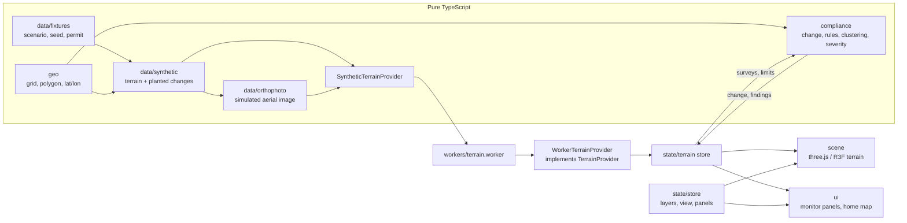

# PitWatch 3D

A browser dashboard that helps a mining inspector check an open-pit mine against its permit from two terrain surveys. It shows the mine as a 3D model, measures what changed between a baseline and a current survey, and runs transparent rules that flag digging outside the lease, digging below the approved floor and dumping outside permitted zones.

PitWatch supports risk-based inspection planning. It does not replace a site visit and does not prove a legal breach.

> **Simulated data.** Venthar Ridge Iron Pit, Ardent Ore Works and every survey here are fictional. The terrain, the aerial images and the planted changes are generated from a fixed seed. The app shows a permanent SIMULATED DATA badge and tags every value with where it came from.

## What it does today

- **Home page** (`#/`): a scroll story on a map drawn from the simulated surveys. It walks through the baseline survey, the current survey, the measured change and the permit check, then shows the rule engine's live result.
- **Monitor** (`#/monitor`):
  - 3D terrain of the current survey with a simulated aerial image draped over it. The block sides show a soil profile.
  - Optional elevation tint, with colours spread so the plateau's relief shows, and optional 5 m contours.
  - Vertical exaggeration from 1× to 3×.
  - Oblique, top and pit camera views, a compass and a live scale bar.
  - Top-bar compliance status, an Overview tab with each rule's result, and a Findings tab where every finding comes with its explanation and figures.
- **Compliance engine** (`src/compliance/`): change detection, rules R1–R3, clustering into findings, severity and plain-English explanations. All of it is pure TypeScript and unit-tested.

Still to come: map overlays (lease fence, buffer, approved floor, change map, finding markers), point picking, a measure tool with a profile chart, the epoch slider and deployment config. See [Roadmap](#roadmap).

## Data honesty

- Every displayed value carries a provenance tag: `measured`, `derived`, `simulated` or `unverified`.
- Elevations are shown as value ± vertical uncertainty (σ).
- No alert is hand-written. Every finding comes from the rule engine running on the two surveys.
- The About data tab explains what different sources can show:
  - satellite imagery shows the surface, not depth;
  - global DEMs (Copernicus GLO-30, SRTM, about 30 m cells, metres of vertical error) are too coarse for bench-scale change;
  - drone, LiDAR or DGPS surveys are what mine-scale monitoring needs.

## The rules

Let σ be the uncertainty of the difference between the surveys, σ = √(σ1² + σ2²), and k = 2.

| Rule        | Checks                                     | Violation                             | Warning                                             |
| ----------- | ------------------------------------------ | ------------------------------------- | --------------------------------------------------- |
| Change      | Δh = current − baseline per cell           |                                       |                                                     |
| R1 Boundary | excavated cells (Δh < −(minChange + kσ))   | centre outside the lease              | inside the lease, within the safety buffer          |
| R2 Depth    | current ground inside an approved pit zone | more than kσ below the approved floor | below the floor but within kσ (cannot be confirmed) |
| R3 Dumping  | filled cells (Δh > +(minChange + kσ))      |                                       | outside every designated dump zone                  |

Flagged cells are grouped into findings with 8-connected components. Each finding has an area, a volume (Σ|Δh| × cell area; for R2, volume below the floor), the largest exceedance, a centroid and a severity. Severity comes from thresholds on area, volume and exceedance:

- a violation is critical or high;
- a warning is medium or low.

Each finding also gets an explanation such as:

> Excavated 8,320 m² outside the lease boundary; deepest cut 52.0 m ± 0.14 m (2σ). About 183,700 m³ removed.

Every threshold (k, `minChangeM`, severity limits) lives in [`src/compliance/config.ts`](src/compliance/config.ts).

The seeded scenario produces exactly these findings, locked by a snapshot test:

| Id   | Finding                                                   | Status              |
| ---- | --------------------------------------------------------- | ------------------- |
| R1-1 | Pushback of the east wall past the lease edge             | violation, critical |
| R2-1 | Sump dug about 4 m below the approved floor               | violation, high     |
| R1-2 | The same pushback where it crosses the 20 m safety buffer | warning             |
| R3-1 | Truck-tipped heaps outside the dump zone                  | warning             |
| R1-3 | Shallow scrape inside the safety buffer                   | warning, low        |

## Run it

Requires Node 20.19+ or 22.12+ (what Vite 8 needs) and npm.

```sh
npm install
npm run dev          # http://localhost:5173
```

| Command                           | What it does                                 |
| --------------------------------- | -------------------------------------------- |
| `npm run dev`                     | Dev server with hot reload                   |
| `npm run typecheck`               | TypeScript, strict                           |
| `npm run lint`                    | ESLint                                       |
| `npm test`                        | Vitest, once (`npm run test:watch` to watch) |
| `npm run build`                   | Typecheck and production build into `dist/`  |
| `npm run preview`                 | Serve the production build                   |
| `npm run format` / `format:check` | Prettier                                     |

The terrain (two 257 × 257 surveys at 8 m plus their aerial images) is generated in a Web Worker when the page opens. This takes about a second and a half.

## Architecture



- `src/domain`, `src/data`, `src/geo` and `src/compliance` are pure TypeScript. ESLint blocks React, three.js and Zustand imports there, so the geometry and rules are testable on their own.
- `TerrainProvider` (`getMine`, `listSurveys`, `getSurvey`, `getLimits`) is the seam for real data. A GeoTIFF DEM or surveyed-surface provider can replace the synthetic one without touching rendering or rules.
- Coordinates are a local metric grid (X east, Y north, RL in metres). The fictional origin lat/lon is for display only; a real system would use a projected CRS such as UTM.

```text
src/
  domain/       types: Mine, TerrainSurvey, PermittedLimits, ComplianceFinding, TerrainProvider
  data/         seeded RNG and noise, scenario fixtures, synthetic terrain, aerial image, providers
  geo/          grid maths, point-in-polygon, distances, area and volume, lat/lon display
  compliance/   change detection, R1–R3, connected components, severity, explanations
  scene/        R3F terrain, shaders (aerial/tint blend, contours, soil profile), camera rig
  state/        Zustand stores: app UI state, loaded terrain and findings
  ui/           home page, monitor layout, panels, map HUD
  workers/      terrain generation off the main thread
```

## Stack

Vite, React 19, TypeScript (strict), three.js with @react-three/fiber and drei, Tailwind CSS v4, Zustand, Vitest, ESLint and Prettier. There is no backend: everything runs in the browser.

## Roadmap

|     | Milestone                                                                   | Status |
| --- | --------------------------------------------------------------------------- | ------ |
| M1  | App shell, tooling                                                          | done   |
| M2  | Domain types, geo utilities, synthetic terrain                              | done   |
| M3  | 3D terrain view                                                             | done   |
| M4  | Compliance engine and scenario snapshot                                     | done   |
| M5  | Overlays: lease fence, buffer, approved floor, change map, finding markers  | next   |
| M6  | Panels: point picking, measure tool and profile chart, epoch slider, fly-to |        |
| M7  | Polish: accessibility, performance                                          |        |
| M8  | Deployment config (Vercel or Netlify) and final checks                      |        |

`CLAUDE.md` keeps a detailed log of every change.
